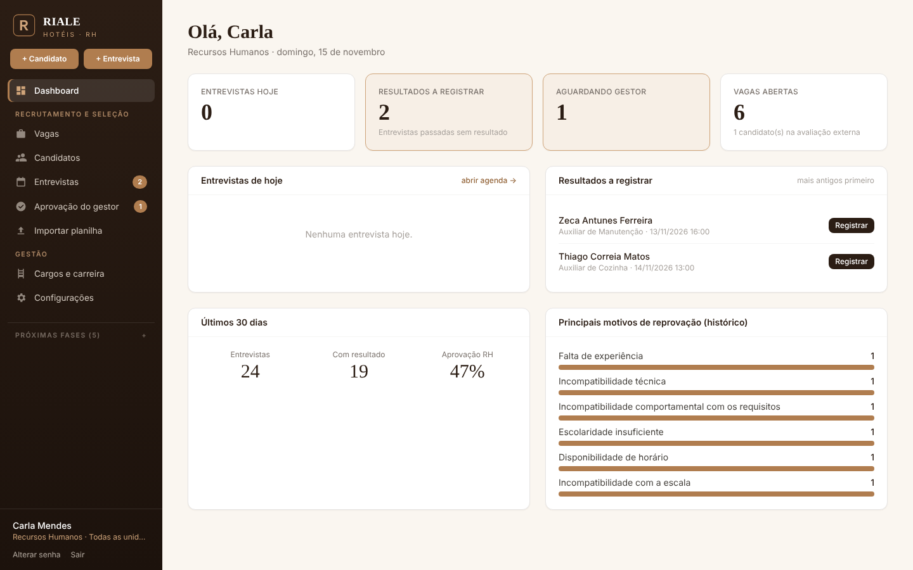

# Riale RH — Plataforma interna de Recursos Humanos

Plataforma web interna da **Riale Hotéis** (Brisa Barra, Imperial e Vilamar). Ela foi
construída para receber, em fases, os módulos de recrutamento, admissão, remuneração,
indicadores e carreira.

> **Fase atual: 1 — Fundação.** Inclui autenticação por CPF + senha, perfis e permissões,
> estrutura organizacional (unidades, departamentos, cargos, gestores e superiores diretos,
> usuários do RH), API interna `/api/v1`, auditoria, proteção de dados pessoais (LGPD),
> documentos cifrados e backups. Os módulos de negócio aparecem no menu com a indicação
> **"em breve"**.



| Documento | Conteúdo |
|---|---|
| [`docs/DEPLOY-VERCEL.md`](docs/DEPLOY-VERCEL.md) | **Publicação em produção (Vercel + Neon) e primeiro acesso** |
| [`docs/ARQUITETURA.md`](docs/ARQUITETURA.md) | Arquitetura, decisões técnicas, modelo de dados, segurança/LGPD, roadmap e riscos |
| Este README | Instalação, execução, usuários de teste, testes, backup e deploy |

---

## 1. Requisitos

| Item | Versão |
|---|---|
| Node.js | 20 LTS ou superior (testado com 22) |
| PostgreSQL | 14 ou superior (testado com 16) — ou Docker |
| npm | 10+ |

## 2. Instalação (primeira vez)

```bash
git clone <repositório> && cd Onboarding
npm install
```

Suba o PostgreSQL. Se você tem Docker, use o arquivo incluído:

```bash
docker compose up -d
```

Crie o `.env` a partir do modelo e **gere segredos próprios**:

```bash
cp .env.example .env
```

```bash
openssl rand -base64 32
```

Rode o comando acima três vezes e cole cada resultado em `AUTH_SECRET`,
`CPF_HASH_PEPPER` e `DATA_ENCRYPTION_KEY`, no `.env`.

> ⚠️ `CPF_HASH_PEPPER` e `DATA_ENCRYPTION_KEY` protegem os CPFs e os documentos.
> **Se forem perdidas, os dados cifrados ficam ilegíveis.** Em produção, guarde-as em
> um cofre (AWS Secrets Manager, 1Password, Vault), separadas dos backups do banco.

Crie as tabelas e carregue os dados iniciais. Para desenvolvimento, use a versão com
usuários de demonstração:

```bash
npx prisma migrate deploy
```

```bash
npm run db:seed:demo
```

`npm run db:seed` carrega **só a estrutura** (unidades, departamentos, cargos, trilhas e
permissões), sem nenhum usuário: é o que roda em produção. Nesse caso o primeiro
administrador é criado na tela **`/primeiro-acesso`**, que exige `BOOTSTRAP_ADMIN_CPF` e
`BOOTSTRAP_TOKEN` no `.env`.

## 3. Execução

Desenvolvimento (recarga automática):

```bash
npm run dev
```

Produção local:

```bash
npm run build && npm start
```

Acesse **http://localhost:3000**.

### Usuários de teste (somente com `npm run db:seed:demo`)

Senha de todos: **`Riale@2026Seguro`**

| Perfil | Nome | CPF (login) | Escopo |
|---|---|---|---|
| Administrador | Administrador do Sistema | `529.982.247-25` | Todas as unidades |
| RH (corporativo) | Carla Mendes | `111.444.777-35` | Todas as unidades |
| RH (unidade) | Paulo Henrique Lima | `390.533.447-05` | Apenas Brisa Barra |
| Gestor | Marina Souza | `168.995.350-09` | Leitura; vinculada ao cadastro de gestora da Recepção (Brisa Barra) |

> Estes CPFs são fictícios (apenas válidos matematicamente) e **nunca são criados em
> produção**: o seed recusa `SEED_DEMO` no ambiente de produção da Vercel.

## 4. Testes

| Comando | O que verifica |
|---|---|
| `npm run typecheck` | Tipagem TypeScript |
| `npm run lint` | Padrões de código |
| `npm test` | Unitários: CPF, criptografia, política de senha, mascaramento da auditoria, catálogo de permissões |
| `npm run test:integration` | Serviços contra o PostgreSQL real: escopo por unidade, anti-escalonamento de perfil, hierarquia sem ciclos, CPF protegido, imutabilidade da auditoria, integridade referencial |
| `npm run test:e2e` | Navegador real (Playwright) contra o servidor rodando: login, perfis, cadastros, validação, LGPD, documentos, recuperação de senha, bloqueio, responsividade |
| `npm run test:e2e:first-access` | Banco de produção vazio: primeiro acesso (CPF + código), cadastro dos demais usuários, troca obrigatória de senha |

O E2E exige o servidor no ar (`npm start`) e o Playwright instalado
(`npm i -D playwright && npx playwright install chromium`). Capturas de tela ficam em
`tests/e2e/screenshots/`.

**Resultado na entrega:** 7/7 unitários, 10/10 de integração, 15/15 cenários E2E e 12/12 do
primeiro acesso. Este último rodou sobre um banco vazio, com o mesmo `vercel-build` usado na
Vercel.

## 5. Backup e restauração

```bash
npm run db:backup
```

Gera em `backups/` o dump do banco (`pg_dump`, formato custom), um pacote com os
documentos (que já ficam cifrados em disco) e um arquivo de checksums SHA-256. Também
apaga os backups com mais de `BACKUP_RETENTION_DAYS` dias. Se `BACKUP_GPG_RECIPIENT`
estiver definido, os arquivos são cifrados com GPG.

```bash
npm run db:restore -- backups/riale_rh_db_<data>.dump
```

Restauração com confirmação explícita. A restauração foi testada nesta entrega: um banco
restaurado reproduziu contagens e travas idênticas às do original.

**Produção:** agende o backup diariamente (cron/systemd timer) e copie para um
armazenamento externo (S3 com versionamento ou outra nuvem). Um backup que nunca foi
restaurado não é backup: faça um teste de restauração por trimestre.

## 6. Deploy em produção

Siga o guia **[`docs/DEPLOY-VERCEL.md`](docs/DEPLOY-VERCEL.md)**: Vercel (região São Paulo) +
Neon (São Paulo), sem usuários de teste e com primeiro acesso protegido por CPF + código. O
build (`npm run vercel-build`) valida as variáveis, aplica as migrações, carrega a estrutura
e compila.

## 7. Estrutura de pastas

```
prisma/
  schema.prisma            modelo de dados (PostgreSQL)
  migrations/              migrações versionadas (inclui travas de banco)
  seed.ts                  dados iniciais idempotentes
src/
  app/
    (app)/                 área autenticada (menu lateral)
      dashboard/ vagas/ candidatos/ entrevistas/ admissoes/ colaboradores/
      remuneracao/ pesquisa-salarial/ cargos/ relatorios/ configuracoes/
    api/v1/                API interna versionada
    login/ recuperar-senha/ redefinir-senha/ trocar-senha/ acesso-negado/
  modules/                 regras de negócio por módulo (usadas pela UI e pela API)
    org/ managers/ users/ auth/ permissions/ settings/ documents/ notifications/ audit/ shared/
  lib/                     infraestrutura: auth, sessão, cripto, CPF, auditoria, permissões
  components/              componentes de interface
tests/                     unit/ integration/ e2e/
scripts/                   backup.sh, restore.sh
docs/                      arquitetura e imagens
python_app/                LEGADO — versão Django do MVP anterior (congelada; ver LEGADO.md)
```
