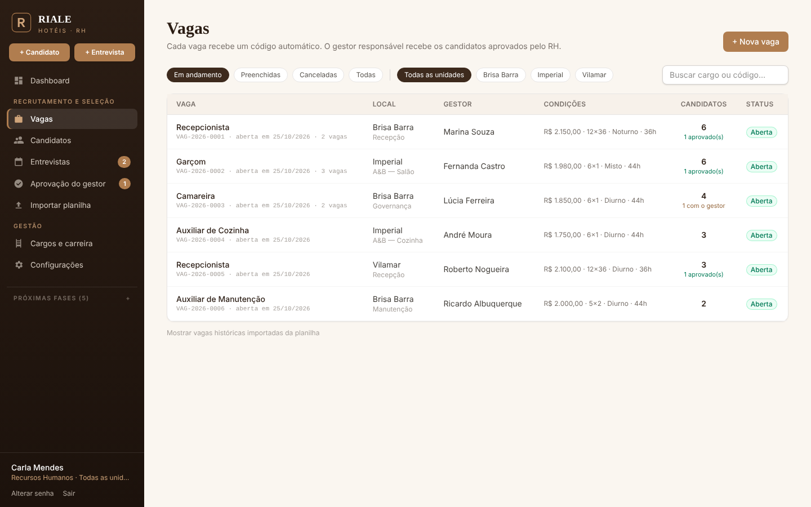
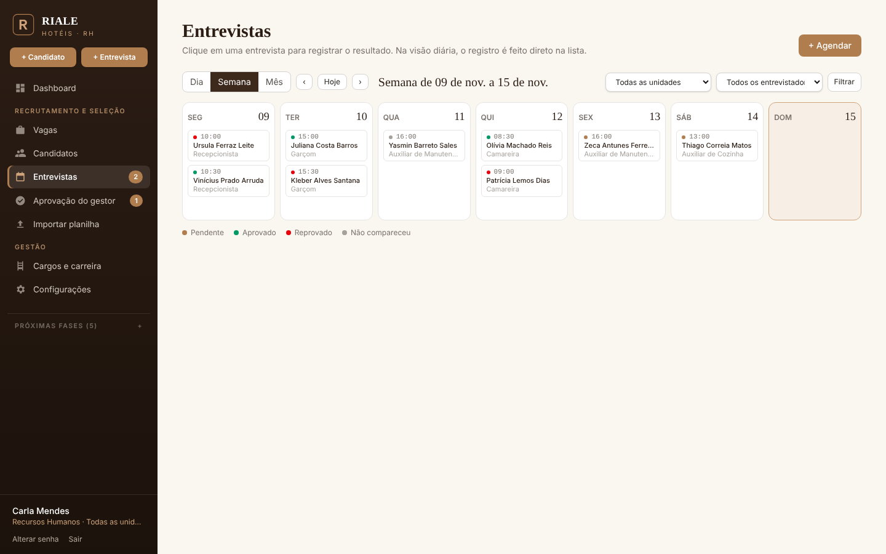
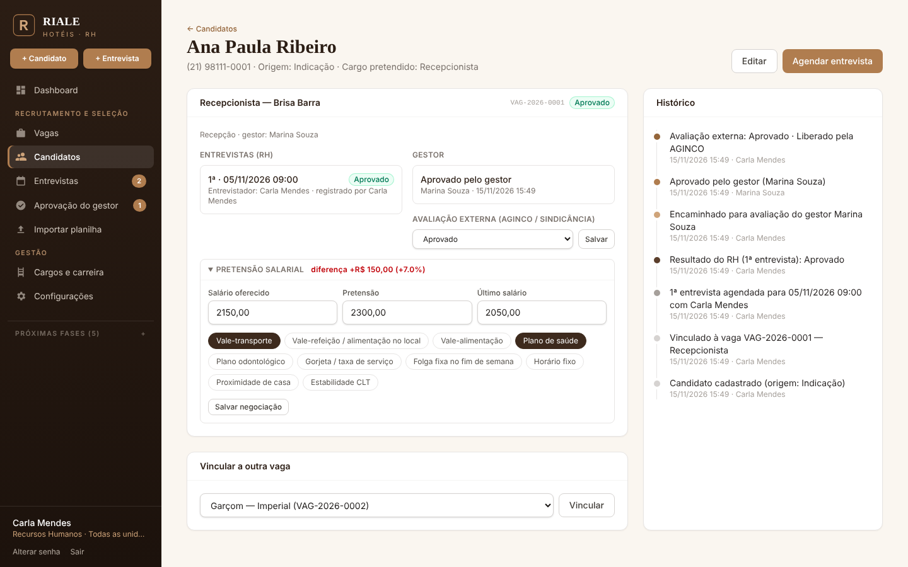
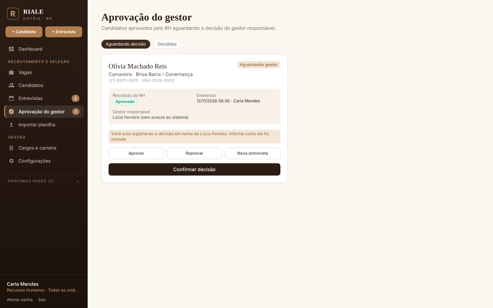

# Fase 2 — Recrutamento e seleção

Módulo que substitui a planilha de controle de entrevistas do RH: vagas, candidatos, agenda,
resultados, aprovação do gestor, histórico e importação do histórico da planilha.

| Vagas | Agenda (semana) |
|---|---|
|  |  |
| **Ficha do candidato com histórico** | **Aprovação do gestor** |
|  |  |

*Imagens com os dados fictícios de demonstração (`npm run db:seed:demo`).*

## 1. Como o RH usa no dia a dia

| Tarefa | Onde | Tempo típico |
|---|---|---|
| Abrir uma vaga | **Vagas › + Nova vaga**: escolha cargo e unidade. O departamento é sugerido pelo cargo e o gestor vem da estrutura | ~1 min |
| Cadastrar candidato | **+ Candidato** (botão fixo no topo do menu): nome, telefone, vaga e origem. O cargo pretendido vem da vaga | ~30 s |
| Agendar | **+ Entrevista**: escolha a vaga, a data e o horário e marque um ou vários candidatos. Os horários são distribuídos em sequência automaticamente | ~30 s para vários |
| Registrar o resultado | **Entrevistas › Dia**: em cada linha, 1 clique no resultado (+ motivo, se for reprovação) e "Registrar" | < 10 s |
| Acompanhar o gestor | **Aprovação do gestor**: lista o que está pendente e com quem | — |
| Consultar o histórico | **Candidatos › nome**: linha do tempo com cada etapa, data, responsável e motivo | — |

Na entrada, o **Dashboard** mostra as entrevistas do dia, os resultados atrasados (entrevistas
que já passaram sem resultado), os candidatos aguardando o gestor e os principais motivos de
reprovação.

### Regras aplicadas pelo sistema

- **Duplicidade:** antes de salvar um candidato, o sistema procura o mesmo telefone, o mesmo
  e-mail e o mesmo nome ou um nome parecido. Se encontrar, o RH escolhe entre *usar o cadastro
  existente* (o candidato apenas é vinculado à nova vaga) ou *confirmar que é outra pessoa*.
- **Resultado do RH:** Aprovado, Reprovado, Pendente, Não compareceu ou Desistiu.
  - A reprovação exige um motivo da lista padronizada.
  - O motivo "Outro" exige uma observação.
  - Na desistência, o motivo é opcional; quando é salário, alimenta a inteligência de mercado.
- **Aprovado pelo RH → gestor:** cria automaticamente a avaliação do gestor responsável pela
  vaga e envia um e-mail a ele (pela fila de notificações). O gestor pode:
  - aprovar;
  - reprovar, com justificativa obrigatória;
  - pedir nova entrevista, e nesse caso o RH é avisado.
- **Gestor sem acesso ao sistema:** o RH registra a decisão "em nome do gestor", informando
  como ela foi tomada. A decisão fica marcada assim no histórico.
- **Separação das decisões:** o resultado do RH (na entrevista) e a decisão do gestor (na
  avaliação) são registros diferentes. A situação final da candidatura é calculada a partir dos
  dois e da avaliação externa.
- **Avaliação externa (AGINCO / sindicância):** é opcional. Ao aprovar, o RH marca "enviar para
  avaliação externa". Uma reprovação externa reprova a candidatura; a aprovação final depende
  do gestor e da avaliação externa.
- **Pretensão salarial:** informe oferta, pretensão, último salário e benefícios valorizados.
  A diferença entre pretensão e oferta, em reais e em %, é calculada na hora.
- **Histórico:** cada etapa gera um registro que não pode ser alterado nem apagado (trava no
  banco). Ele guarda o entrevistador, a data, o resultado, o motivo, quem decidiu e as
  movimentações.
- **Permissões:**
  - **RH** cadastra e registra resultados; o RH de unidade só vê a sua unidade.
  - **Gestor** vê apenas as vagas que gere e decide sobre os candidatos encaminhados a ele.
  - **Importação** é exclusiva de Admin e RH.

## 2. Importação da planilha atual

Menu **Importar planilha** (Admin/RH). O processo é feito em 4 passos e nada é gravado antes
da confirmação:

1. **Enviar** o arquivo .xlsx ou .csv. No Google Planilhas: *Arquivo › Fazer download ›
   Microsoft Excel*.
2. **Colunas:** o sistema reconhece os cabeçalhos (Unidade, Data entrevista, Candidato, Vaga,
   Recrutador, "Aprovado pelo RH?", Motivo, além de Telefone, E-mail, Setor e Origem, quando
   existirem).
3. **Correspondências:** cada grafia diferente é ligada ao cadastro certo. Por exemplo,
   "Ass. Governança", "Assistente de Governaça" e "ass de governança" viram *Assistente de
   Governança*. As escolhas ficam gravadas no cargo e valem para as próximas importações.
4. **Revisão:** cada linha mostra o que será gravado e é classificada como pronta, pronta com
   observação, duplicada na planilha, já existente no sistema ou inconsistente (data inválida,
   unidade desconhecida). O RH pode ignorar uma linha, mas precisa informar o motivo.

Ao importar, o sistema cria:
- os candidatos; um mesmo nome em duas etapas, como "Fulano 2º etapa", vira o mesmo candidato
  com duas entrevistas;
- uma vaga histórica por unidade e cargo;
- as entrevistas, com data, entrevistador, resultado, motivo e o texto original preservado;
- a avaliação externa, a decisão do gestor quando a planilha a registra, e o histórico.

O **relatório CSV** lista as linhas uma a uma, com o que aconteceu com cada uma. Reimportar o
mesmo arquivo não duplica nada.

### Como a coluna "Aprovado pelo RH?" é interpretada

A planilha real tem **31 grafias** nessa coluna, que se reduzem a 26 formas distintas depois
de padronizar maiúsculas e espaços. Cada uma vira um desfecho explícito, e o RH pode corrigir
qualquer interpretação na tela antes de importar:

| Exemplos na planilha | Desfecho no sistema |
|---|---|
| Sim, SIM, Aprovado, Sim/ | Aprovado pelo RH (desfecho seguinte não registrado) |
| Sim/aguarda Aginco, Sim /Aguardando AGINCO, Sim/ aguarda sindicância | Aprovado pelo RH · aguardando avaliação externa |
| Sim / Reprovado Aginco, Reprovado Aginco | Aprovado pelo RH · reprovado na avaliação externa |
| Sim + motivo "Aprovado - AGINCO" | Aprovado pelo RH · aprovado na avaliação externa |
| Sim/declinou | Aprovado pelo RH · candidato desistiu |
| Sim/ Aguarda entrevista com a Ana, Aprovado Sara/ Dúvida Tiago | Aprovado pelo RH · aguardando gestor / próxima entrevista |
| Sim RH /Não gestor | Aprovado pelo RH · reprovado pelo gestor |
| Não, Reprovado | Reprovado pelo RH |
| Não/ Reprovado Aginco | Reprovado pelo RH e na avaliação externa |
| Declinou | Candidato desistiu |
| Não aceitou salário / a proposta | Candidato não aceitou a proposta (motivo: pretensão salarial) |
| Banco de Talentos | Banco de talentos |
| (vazio), Buscar referência, Analisar com Eduardo, Aguarda entrevista com… | Pendente |

O texto livre da coluna **Motivo** é classificado na lista padronizada. Por exemplo, "Não
aderente à cultura" vira *Incompatibilidade comportamental*, "faixa salarial acima" vira
*Pretensão salarial* e "dupla jornada" vira *Disponibilidade de horário*. O texto original fica
na observação. Valores em R$ citados no texto ("ganhando R$ 2.600") são extraídos para o último
salário ou para a pretensão e marcados para conferência.

### Resultado do teste com a planilha real (93 linhas, set–nov/2026)

- **93 de 93 linhas importadas**, sem nenhuma descartada.
- **90 candidatos:** 3 pessoas aparecem em duas etapas e foram unificadas.
- **26 vagas históricas.**
- **38 grafias de cargo** ligadas a 20 cargos do catálogo.
- Avisos de qualidade dos dados, que não impediram a importação:
  - 93 linhas sem telefone;
  - 12 nomes incompletos (só o primeiro nome);
  - 2 reprovações sem motivo.

## 3. O que a planilha revela (para decisão da gestão)

Dados de 92 candidaturas, de setembro a novembro de 2026:

| Unidade | Candidaturas | Aprovadas pelo RH | Aprovação final | Reprovadas | Desistências | Passaram pela AGINCO | Reprovadas na AGINCO |
|---|---|---|---|---|---|---|---|
| Brisa Barra | 49 | 29 | 17 | 11 | 4 | 11 | 3 |
| Imperial | 32 | 15 | **4** | 17 | 4 | 9 | 3 |
| Vilamar | 11 | 7 | 6 | 3 | 1 | 1 | 0 |
| **Total** | **92** | **51** | **27** | **31** | **9** | **21** | **6** |

Pontos de atenção:

1. **A Imperial converte muito menos.** São 4 aprovações finais em 32 candidaturas (12%),
   contra 35% na Brisa Barra. Ou o perfil das vagas é mais difícil (A&B, cozinha), ou a
   atração e a triagem estão trazendo candidatos menos aderentes. Vale olhar por cargo.
2. **"Não aderente à cultura" responde por 60% das reprovações com motivo** (15 de 25). É um
   motivo vago: não ajuda a melhorar a atração e pode ser questionado juridicamente quando não
   há critério objetivo. Recomendo definir de 3 a 5 comportamentos observáveis por família de
   cargo e usá-los na entrevista. A lista de motivos já permite detalhar isso em
   *Configurações › Motivos*.
3. **A AGINCO reprova 29% de quem avalia** (6 de 21), e isso acontece no fim do processo,
   depois que RH e gestor já investiram tempo. Se o custo e o prazo da AGINCO permitirem,
   antecipar a etapa (ou uma pré-checagem) reduz o retrabalho.
4. **Cerca de 10% das candidaturas terminam em desistência**, quase sempre por salário,
   horário ou contratação PJ. Com a pretensão registrada sistematicamente a partir de agora,
   a fase de Pesquisa salarial vai mostrar onde a oferta está abaixo do mercado.
5. **Dois motivos recorrentes estão fora da lista padronizada:** distância/deslocamento
   (3 casos) e modalidade PJ (2 casos). Hoje caem em "Outro". Sugiro incluí-los como motivos
   próprios.
6. **Qualidade do dado:** nenhuma linha tinha telefone, e 12 candidatos têm só o primeiro
   nome. No sistema, o telefone passa a ser obrigatório para novos cadastros, o que viabiliza
   a checagem de duplicidade e o contato.

## 4. Decisões de modelagem

| Decisão | Por quê |
|---|---|
| Cargo como catálogo corporativo, com **apelidos** (grafias aprendidas) e **área padrão** | A planilha mostra 38 grafias para cerca de 20 cargos. Sem catálogo, a análise por cargo e a futura pesquisa salarial ficam impossíveis |
| **Candidatura** (candidato × vaga) separada do candidato | Um candidato pode concorrer a várias vagas sem duplicar o cadastro; a negociação salarial é por vaga |
| Resultado do RH na **entrevista** e decisão do gestor na **avaliação do gestor** | Requisito explícito de separar os dois; também permite medir divergência RH × gestor |
| **Avaliação externa** como campo próprio | Aparece em 17 linhas da planilha; sem ela, a importação perderia informação |
| Motivos em **tabela editável**, com `code` estável | Os relatórios dependem de códigos fixos; o RH ajusta os nomes e inclui novos motivos sem programação |
| Histórico **somente-inserção** | Rastreabilidade de quem decidiu o quê, inclusive em contestações trabalhistas |
| Vagas da importação marcadas como **históricas** e encerradas | Não poluem a lista de vagas abertas, mas preservam o histórico por unidade e cargo |
| Telefone obrigatório só no cadastro manual | Os registros históricos não têm telefone; exigi-lo bloquearia a importação |

## 5. Testes

| Suíte | Cobertura |
|---|---|
| `npm test` (unitários) | As 26 grafias reais de resultado, motivos, extração de salários, nomes e etapas, datas (incluindo 31/02 inválido), telefones e fuso de São Paulo |
| `npm run test:integration` | **Simulação de 24 candidatos** em 6 vagas e 3 unidades, com todos os desfechos; separação RH × gestor; decisões em nome do gestor; histórico imutável; duplicidade; regras de motivo e justificativa; escopo por perfil; importação com duplicatas, inconsistências e reimportação |
| `npm run test:e2e:recrutamento` (navegador) | O RH cria a vaga, cadastra candidatos (com a verificação de duplicidade), agenda 2 em lote e registra os resultados na agenda; a gestora decide (a reprovação exige justificativa); confere o histórico; importa a planilha pela tela |

`npm run db:seed:demo` carrega os mesmos 24 candidatos fictícios para demonstração.
